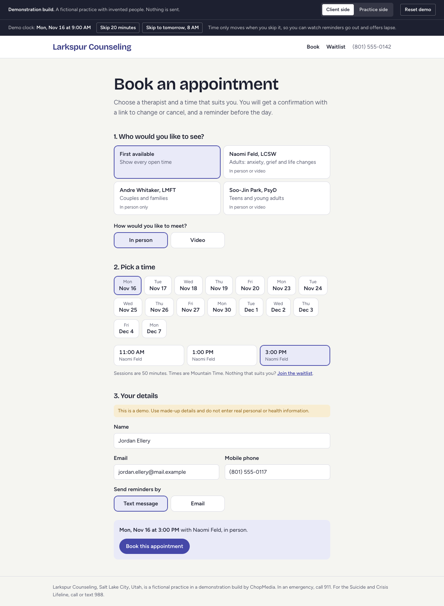
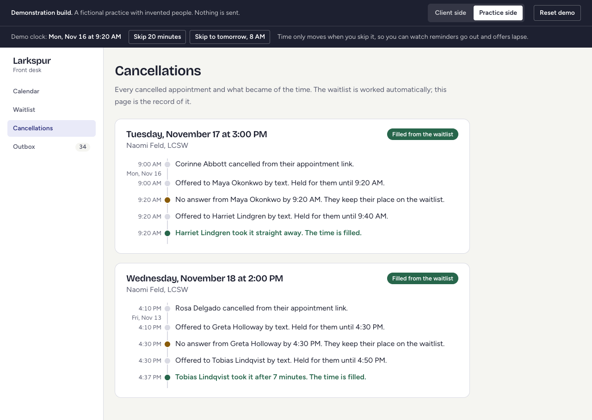
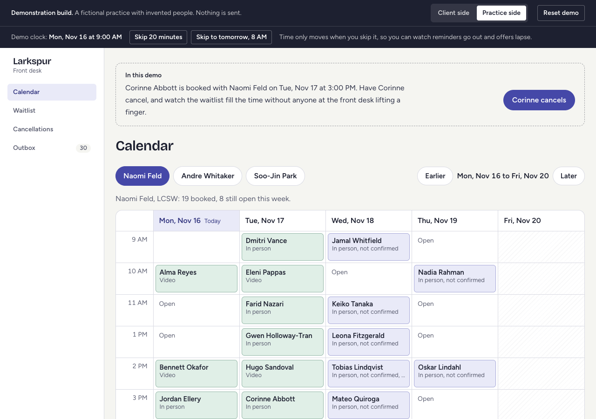
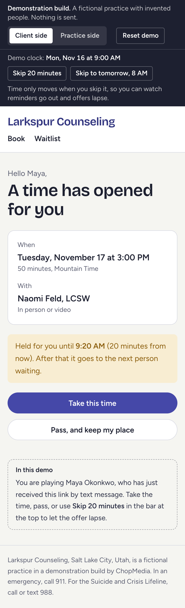

# Therapy practice scheduler

A cancelled appointment fills itself: the time is offered to the waitlist, one person at a time, before anyone at the front desk picks up a phone.

> **Demo project.** This is a demonstration build by ChopMedia, not client work. Larkspur Counseling is a fictional practice. Every therapist, client, phone number and email address in it is invented, and nothing is ever sent to anyone. It is designed with HIPAA in mind, and it is not HIPAA compliant or certified. Do not put real personal or health information into it.



**Live demo:** https://therapy-practice-scheduler.vercel.app

## The problem

In a small therapy practice, a cancellation the day before is an empty hour. Filling it means someone at the front desk working down a waitlist by phone: who wanted Tuesdays, who only sees a particular therapist, who has been waiting longest. Most of those calls go to voicemail. Usually the hour stays empty, and the people on the waitlist keep waiting for a time that was there all along.

Booking has the same shape. Clients call during the day, when the therapists are in session and the client is at work, and the two sides trade messages to settle on a time a calendar already knew was free.

## What it does

- **Clients book online.** They choose a therapist, in person or video, and an open time. The same time cannot be booked twice, and that is enforced by the database, not only by the screen.
- **Reminders go out 48 hours and 2 hours before**, each with a link to confirm or cancel. No sign-in or account is needed.
- **Clients join a waitlist** with the days, times of day and therapist that would suit them.
- **A cancelled time is offered to the waitlist straight away.** It goes to the person who has waited longest among those it suits, and is held for them for 20 minutes. If they pass or do not answer, it goes to the next person. If nobody takes it, it opens for online booking.
- **The front desk sees the reasons.** Before cancelling, the appointment shows who would be offered the time, in order, and who would be skipped and why. Afterwards there is a timeline of what happened.
- **Messages give away nothing.** Reminders and offers carry a time and a link. They never name the therapist, the kind of visit or the kind of practice, so they are safe to arrive on a lock screen.

## Try it

Three things worth clicking first:

1. Switch to **Practice side** and press **Corinne cancels**. Her 3:00 PM tomorrow is offered to Maya, who has waited longest among the people it suits. Press **Open the link Maya received** and take the time as her.
2. Reset the demo, do the same, and this time press **Skip 20 minutes** in the top bar instead of answering. Maya's offer lapses and the time passes to the next person, with the whole story on the timeline.
3. On the **Client side**, book an appointment as the sample client, then find it on the practice calendar and open the **Outbox** to read the messages it produced.

The demo runs on its own clock, shown in the top bar. Time only moves when you skip it. **Reset demo** puts everything back.



| The week's calendar | The offer, on a phone |
| --- | --- |
|  |  |

## How it would plug into a real practice

The demo stands alone so that anyone can try it. In a real installation:

- **The calendar of record.** Appointments and working hours would be read from, and written back to, the system the practice already uses (SimplePractice, TherapyNotes, Jane and similar, or Google Calendar), so this does not become a second calendar to keep in step.
- **Text messages and email.** Sent through providers that will sign a business associate agreement. The demo writes every message to the outbox instead.
- **Staff sign-in and roles.** The demo has none, because every visitor gets a private copy of the sample data.
- **The rules are the practice's own.** Session length, how long an offer is held, how late a time is still worth offering, who goes first on the waitlist: each is a named setting or one short function. One rule the demo leaves out on purpose is quiet hours: here an offer goes out at whatever time the cancellation happens, and a real practice would set the hours during which clients may be texted.
- **Video sessions.** The demo records that an appointment is by video. A real one would link to the practice's video service.

## Privacy and HIPAA

This demo is designed with HIPAA in mind. It is not HIPAA compliant or certified, and no demo could be: compliance belongs to an organization and how it runs a system, not to a piece of software.

What the design already does:

- Collects the minimum. There is no "reason for visit" box and no clinical information anywhere.
- Keeps health details out of messages, as described above.
- Uses unguessable links for clients instead of accounts and passwords.
- Keeps each visitor's sample data separate from every other visitor's.

What a real installation would add, and what would be reviewed with the practice before going live: business associate agreements with the hosting, database and messaging providers; staff sign-in with roles and a record of who looked at what; encryption and backup arrangements that are written down and tested; and a retention and deletion policy.

## What this demo is not

- It is not HIPAA compliant or certified, and it is not a place for real client information.
- It gives no medical or clinical advice and has no AI in it. Every decision is a written rule that the front desk can read.
- There are no usage numbers, clients or testimonials, because it is a demonstration.

## Tech stack and architecture

Next.js 16 (App Router, React 19, TypeScript), Tailwind CSS 4, Drizzle ORM on Postgres, Zod, Vitest.

```
src/
  app/                  pages: booking, waitlist, client links (/a, /offer), practice side (/practice)
  components/           booking flow, waitlist form, demo bar, navigation
  lib/
    time.ts             every date calculation, in the practice's time zone
    slots.ts            which times can be booked
    waitlist.ts         who is offered an opened time, and why
    messages.ts         the wording of every text and email
  server/
    workflow.ts         every state change: book, confirm, cancel, offer, accept, expire, remind
    actions.ts          thin server actions over the workflow
    queries.ts          what each screen reads
  db/                   schema, seed data, per-visitor sandboxes
```

Decisions worth knowing about:

- **Double booking is impossible, not just unlikely.** A unique index allows one live appointment per therapist and time, and another allows one outstanding offer per opened time. Two people pressing the button at the same moment cannot both win.
- **Time zones are handled in one file.** Times are stored as instants and worked out in the practice's zone, with tests across both daylight saving changes.
- **The clock is an input.** Nothing in the workflow asks the computer what time it is. That is what makes the demo clock possible, and it is also why the tests can replay a whole day of lapsing offers and reminders in a few milliseconds. A real installation would run the same function from a scheduled job every minute.
- **The core logic is plain functions with tests.** The workflow tests run against a real in-memory Postgres.
- **Every visitor gets their own sandbox.** A cookie names a private copy of the sample data, created on first visit and deleted after 48 hours. One consequence: a client link only opens in the browser that created it.
- **No paid services and no keys.** Locally the app runs on an embedded Postgres (PGlite) stored in `.data/`. With `DATABASE_URL` set it uses a normal Postgres server.

## Run it locally

Needs Node.js 20.9 or newer.

```bash
npm install
npm run dev
```

Open http://localhost:3000. The database is created and filled with sample data on first visit. No settings are required.

```bash
npm test            # unit and workflow tests
npm run typecheck
npm run lint
npm run db:reset    # delete the local database and start fresh
```

To use a Postgres server instead of the embedded database, set `DATABASE_URL` to its connection string and run `npm run db:migrate`.

---

Built by ChopMedia. Contact Hayden Huelskamp at chopscales@gmail.com, or on [LinkedIn](https://www.linkedin.com/in/hayden-huelskamp-547a86302/).
